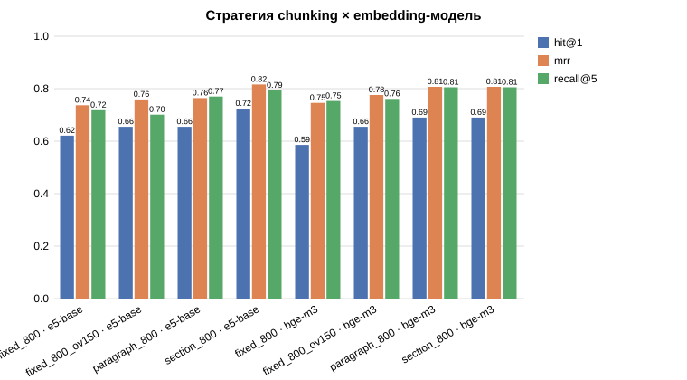
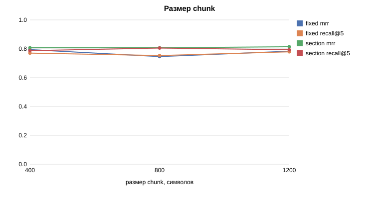
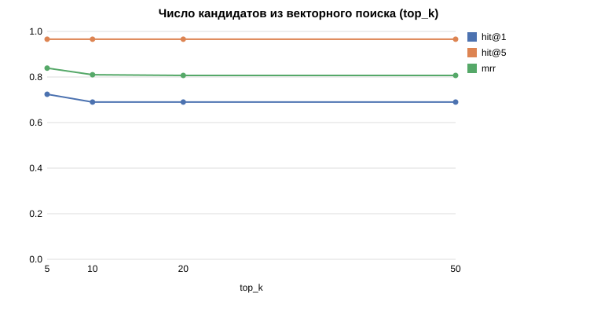
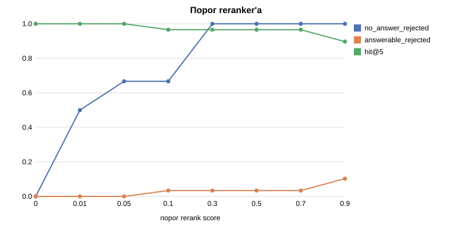

# Лабораторная работа №1. RAG по государству и праву Республики Молдова

RAG-система отвечает на вопросы о государственном устройстве, праве, политике, выборах
и административном делении Республики Молдова. Источник — статьи русской Википедии
(около 300 статей), собранные автоматически через MediaWiki API. Ответ строится только
по найденным фрагментам и сопровождается ссылками на статьи-источники.

**Итоговое качество** (35 вопросов, [финальный прогон](experiments/runs/final/report.md)):
поиск находит нужную статью в top-5 для 97% вопросов (MRR 0,81), correctness ответов
0,84, faithfulness 0,96, все 6 вопросов без ответа в базе получают честный отказ, ложный
отказ — 1 из 29. Конфигурация выбрана по результатам 12 серий экспериментов
([Исследование](#исследование)).

## Стек

| Компонент | Выбор | Почему |
|-----------|-------|--------|
| Окружение | [pixi](https://pixi.sh) + Python 3.12 | Воспроизводимое окружение с lock-файлом, одна команда установки |
| Источник | Русская Википедия, MediaWiki API | Открытый API, номер правки для отслеживания изменений, CC BY-SA. См. [Grabber](#grabber) |
| Vector DB | Qdrant (встроенный режим) | Без Docker, metadata и фильтры рядом с векторами. См. [Embeddings и векторная БД](#embeddings-и-векторная-бд) |
| Embeddings | **bge-m3**; multilingual-e5-base для сравнения | Без reranker'а bge-m3 точнее: MRR 0,806 против 0,728. См. [Исследование](#1-chunking-и-embedding-модели) |
| Reranker | **bge-reranker-v2-m3**; mmarco-mMiniLMv2 для сравнения | Отсекает 6/6 вопросов без ответа; маленький reranker вреден. См. [Исследование](#4-top-k-кандидатов-и-reranker) |
| LLM | **qwen2.5:7b** в Ollama; qwen2.5:3b для сравнения | Локально на RTX 4060 8 GB, бесплатно, данные не уходят наружу. 3B хуже на 0,10 correctness |
| Трейсинг | Langfuse Cloud | Трейсы каждого запроса: что нашёл retriever, что ушло в LLM, задержки |
| UI | Streamlit | Ответ с источниками, найденные chunks со score, настройки поиска (`pixi run ui`) |

## Установка и запуск

1. Установите [pixi](https://pixi.sh/latest/#installation) и [Ollama](https://ollama.com/download).
2. Установите окружение:
   ```bash
   cd lab1
   pixi install
   ```
3. Создайте `.env` из шаблона и впишите ключи Langfuse
   (cloud.langfuse.com → проект → Settings → API Keys):
   ```bash
   cp .env.example .env
   ```
4. Проверьте окружение:
   ```bash
   pixi run check
   ```

5. Скачайте документы (около 5 минут в первый раз, повторные запуски — секунды):
   ```bash
   pixi run grab
   ```
6. Очистите документы и постройте chunks (около 20 секунд):
   ```bash
   pixi run preprocess
   ```
7. Скачайте модели (около 6 ГБ; при зависании добавьте `--no-xet`):
   ```bash
   pixi run download-models
   ```
8. Постройте векторный индекс (около 4 минут на GPU):
   ```bash
   pixi run index
   ```
9. Проверьте поиск:
   ```bash
   pixi run rag retrieve "Кто является президентом Молдовы?"
   ```
10. Загрузите LLM и задайте вопрос:
    ```bash
    ollama pull qwen2.5:7b
    pixi run rag ask "Кто является президентом Молдовы?"
    ```
11. Веб-интерфейс (http://localhost:8501):
    ```bash
    pixi run ui
    ```
12. Оценка на наборе вопросов (~6 минут):
    ```bash
    pixi run eval
    ```

Все команды проекта: `pixi task list`.

## Grabber

Код: [`src/rag/grabber/`](src/rag/grabber/), параметры: секция `grabber` в
[`configs/default.yaml`](configs/default.yaml).

### Выбор источника

Сначала в качестве источника планировалось законодательство РМ с официального портала.
Проверены варианты:

| Источник | Результат проверки | Решение |
|----------|--------------------|---------|
| legis.md (официальный портал) | Весь сайт, включая sitemap, закрыт Cloudflare-challenge: программа получает HTTP 403 | Отклонён: автоматический сбор возможен только обходом защиты от ботов |
| lex.justice.md (старый портал) | Не отвечает (timeout) | Отклонён |
| base.spinform.ru | Бесплатно доступно только оглавление, полный текст платный | Отклонён |
| Wayback Machine | Нужных страниц legis.md нет в архиве | Отклонён |
| Monitorul Oficial | Доступен, но это выпуски газеты в PDF (новые акты и поправки), а не сводные тексты | Отклонён: плохо подходит для вопросов «как устроено» |
| **Русская Википедия** | Открытый MediaWiki API, стабильный JSON, редиректы и номера правок | **Выбран** |

Тема сохранена: государство и право Молдовы (конституция, органы власти, выборы,
партии, госсимволы, административное деление).

### Как работает

```
configs/default.yaml (категории + явные заголовки)
   ↓
MediaWiki API: обход категорий (BFS, глубина ≤ 2) + разрешение редиректов
   ↓
выборка ≈ 311 статей (без дубликатов по pageid, фильтры по названиям)
   ↓
пакетный запрос revid (по 50 статей) ── сравнение с manifest.json
   ↓                                       │
скачать только новые/изменённые           без изменений → пропуск
(action=parse → HTML)
   ↓
data/raw/wikipedia/<pageid>.html + запись в manifest.json
```

| Требование задания | Реализация |
|--------------------|------------|
| Получать данные из источника | `WikipediaClient`: категории, редиректы, ревизии, HTML через `action=parse` |
| Определять новые/изменённые | Сравнение `revid` с манифестом; статьи, выпавшие из выборки, получают статус `removed` |
| Сохранять данные | HTML в `data/raw/wikipedia/`, атомарная запись через временный файл |
| Обрабатывать ошибки | Повторы с экспоненциальной паузой при ошибках сети, 429, 5xx и `maxlag`; ошибка одной статьи не останавливает запуск |
| Не создавать дубликаты | Редиректы склеиваются в один `pageid`; одинаковый контент отсекается по `sha256` |
| Сохранять metadata | `manifest.json`: `document_id`, `title`, `url`, `revid`, `updated_at`, `categories`, `seed`, `sha256` |
| Повторный запуск без подготовки | `pixi run grab`: первый запуск около 5 мин, повторный около 20 с (только проверка `revid`) |

Каждый запуск дописывает итог в `data/raw/runs.jsonl`. Полезные флаги:
`pixi run grab --dry-run` (показать план без загрузки), `pixi run grab --force`
(скачать всё заново).

Вежливость к API: User-Agent с контактом по
[политике Wikimedia](https://meta.wikimedia.org/wiki/User-Agent_policy), последовательные
запросы с паузой, параметр `maxlag=5`.

## Preprocessing

Код: [`src/rag/preprocessing/`](src/rag/preprocessing/), параметры: секции `preprocessing`
и `chunking` в [`configs/default.yaml`](configs/default.yaml).

```
data/raw/wikipedia/*.html
   ↓ html_cleaner.py   удаление шума, HTML → секции с путём заголовков
   ↓ normalize.py      Unicode, ударения, сноски, пробелы
data/processed/documents.jsonl          (311 документов, 2 327 секций)
   ↓ chunking.py       4 стратегии
data/processed/chunks/<стратегия>.jsonl
```

### Очистка

Правила выбраны по частоте элементов в корпусе (подсчёт по всем 311 статьям):

| Элемент | Сколько в корпусе | Что делаем | Почему |
|---------|-------------------|------------|--------|
| `navbox` (навигационные шаблоны) | 520 | удаляем | списки ссылок на другие статьи, один и тот же шум в десятках документов |
| `hatnote` («Не следует путать с…») | 283 | удаляем | служебная навигация |
| `infobox` (карточка) | 273 | **преобразуем** в «Ключ: значение» | плотные факты: столица, президент, население |
| `reflist`, `sup.reference` (сноски) | 271 | удаляем | библиография не отвечает на вопросы |
| `wikitable` (таблицы) | 240 | **преобразуем** в «ячейка \| ячейка» | результаты выборов, составы органов |
| изображения, галереи, плашки `mbox` | ~450 | удаляем | подписи и предупреждения редакторов |
| секции «Примечания», «Ссылки», «Литература», «См. также» | 253 / 202 / 36 / 74 | удаляем вместе с подсекциями | ссылки без содержательного текста |

Результат: из 3,62 млн символов текста HTML остаётся **2,09 млн** чистого текста (−42%).

Пример карточки после очистки (статья «Молдова»):

```
Столица: Кишинёв
Форма правления: парламентская республика
Президент: Майя Санду
Население — Оценка (2025): 2 381 300 чел. (142-е)
```

### Нормализация

| Проблема в корпусе | Пример | Правило |
|--------------------|--------|---------|
| Знаки ударения (300 шт.) | `Молдо́ва` | удалить U+0301: иначе «Молдо́ва» ≠ «Молдова» при поиске |
| Маркеры сносок | `Кишинёв[12]`, `[источник не указан]` | удалить |
| Неразрывные/тонкие пробелы, мягкие переносы | `33 846` | заменить на обычный пробел / удалить |
| Пробелы от склейки HTML | `Бельцы , Тирасполь ( город )` | убрать перед `,.;:)` и после `(` |
| Стрелки трендов из карточек | `↘ 2 381 300` | удалить |

### Chunking

| Стратегия | Как режет | Границы секций |
|-----------|-----------|----------------|
| `fixed` | окно фиксированной длины, только по пробелу | игнорирует |
| `fixed` + `overlap` | то же, соседние окна перекрываются | игнорирует |
| `paragraph` | склеивает целые абзацы/списки/таблицы до лимита | пересекает |
| `section` | целая секция, если влезает, иначе её абзацы | никогда не пересекает |

Общее для всех стратегий: блок длиннее лимита делится по предложениям (строки списков,
таблиц и карточки не режутся), chunks короче 40 символов отбрасываются. У каждого
chunk есть metadata: `chunk_id`, `document_id`, `title`, `url`, `section`, `updated_at`,
`strategy`, `position`.

Целевой размер одинаковый (800 символов ≈ 200 токенов), чтобы сравнивать именно способ
разбиения. Влияние размера и overlap исследуется отдельно на этапе 8.

| Стратегия | Chunks | Средняя длина | Медиана | p95 |
|-----------|--------|---------------|---------|-----|
| `fixed_800` | 2 858 | 753 | 794 | 798 |
| `fixed_800_ov150` | 3 392 | 767 | 795 | 799 |
| `paragraph_800` | 3 479 | 600 | 645 | 785 |
| `section_800` | 4 261 | 490 | 525 | 778 |

`section` даёт больше всего chunks: многие секции короткие (например, «Руководство
партии»), и они не склеиваются с соседними. Это потенциальный минус (мало контекста в
chunk) и потенциальный плюс (chunk о ровно одной теме). Какая стратегия лучше для поиска,
покажет эксперимент на этапе 8.

Посмотреть разбиение конкретной статьи:

```bash
pixi run rag chunks "Конституция Молдовы" --strategy section_800
```

## Embeddings и векторная БД

Код: [`src/rag/embeddings/`](src/rag/embeddings/), параметры: секции `embeddings` и
`active` в [`configs/default.yaml`](configs/default.yaml).

```
data/processed/chunks/<стратегия>.jsonl
   ↓ «Статья. Раздел\n» + текст chunk   (with_header)
   ↓ encoder.py: модель → вектор единичной длины
Qdrant: коллекция <стратегия>__<модель>, payload = metadata chunk
```

### Модели

Требования: русский язык, бесплатная открытая модель, помещается в 8 ГБ видеопамяти
рядом с LLM, контекст ≥ 512 токенов.

| | `intfloat/multilingual-e5-base` | `BAAI/bge-m3` |
|---|---|---|
| Размерность | 768 | 1024 |
| Параметров | 278 M | 568 M |
| Языки | ~100, включая русский | 100+, включая русский |
| Контекст | 512 токенов | 8192 токена (используем 1024) |
| Особенности | обязательные префиксы `query: ` / `passage: ` | без префиксов |
| Скорость на RTX 4060 (fp16) | 319 chunks/с | 127 chunks/с |
| Видеопамять | 0,84 ГБ | 1,5 ГБ |
| Почему выбрана | компактная базовая модель, стандартный baseline для мультиязычного поиска | одна из сильнейших открытых мультиязычных моделей для retrieval |

Длина chunks в токенах (стратегия `section_800`, с заголовком): медиана 153, максимум
478 у обеих моделей. **Ни один chunk не обрезается** контекстом модели — лимит 800
символов (≈ 3,6 символа на токен для русского) выбран с запасом.

### Первое наблюдение: распределение score

Top-1 score на 4 вопросах по теме и 4 вопросах не по теме (`section_800`):

| Модель | По теме | Не по теме («Как приготовить борщ?», «Столица Австралии?»…) | Зазор |
|--------|---------|------------------------------|-------|
| e5-base | 0,869–0,904 | 0,752–0,784 | ≈ 0,09 |
| bge-m3 | 0,674–0,800 | 0,339–0,476 | ≈ 0,20 |

У e5 score сжаты в узкий диапазон (известное свойство модели, связанное с тем, как её
обучали), поэтому отличить «ответа нет в базе» по порогу сложнее. Вывод для фильтрации:
порог similarity нужно подбирать **отдельно для каждой модели**. Подбор на полном
наборе вопросов — на этапе 8.

### Заголовок перед текстом chunk

Перед векторизацией к chunk добавляется `«Название статьи. Раздел»`. Без этого chunk
`Президент: Майя Санду` из карточки статьи «Молдова» не содержит слова «Молдова», и
вопрос «кто президент Молдовы» находит его хуже. Флаг `embeddings.with_header`
позволяет отключить заголовок и сравнить оба варианта в экспериментах.

### Векторная БД: Qdrant (встроенный режим)

| Вариант | Плюсы | Минусы | Решение |
|---------|-------|--------|---------|
| **Qdrant** (local mode) | работает без сервера и Docker; хранит metadata и фильтрует по ней; тот же код переходит на сервер заменой `path=` на `url=` | встроенный режим блокирует папку: один процесс за раз | **выбран** |
| FAISS | очень быстрый поиск | хранит только векторы: metadata, фильтры и удаление пришлось бы писать самим | отклонён |
| Chroma | простой API, тоже без сервера | менее выразительные фильтры, больше зависимостей | отклонён |
| Qdrant / Milvus / Weaviate в Docker | масштабируются на миллионы векторов | нужен Docker, избыточно для ~4 тыс. векторов на коллекцию | отклонены |

Метрика — cosine similarity: векторы нормализуются, поэтому score лежит примерно в
диапазоне [0, 1] и сопоставим между запросами. Это пригодится для порога в фильтрах.

Одна коллекция — одна пара «стратегия × модель» (2 модели × 4 стратегии = 8 коллекций).
Так эксперименты переключаются между комбинациями без переиндексации.

### Инкрементальная индексация

У каждого вектора хранится `embed_hash` = хеш(модель, префикс, длина контекста, текст).
Повторный `pixi run index` пересчитывает только chunks с изменившимся хешем и удаляет
пропавшие. Если поменять модель или флаг `with_header`, коллекция пересчитается
автоматически.

```bash
pixi run index                                   # все модели × все стратегии
pixi run index -m bge-m3 -s section_800          # одна коллекция
pixi run rag search "Кто президент Молдовы?"     # поиск без LLM, top-5
pixi run rag search "..." -m e5-base -s fixed_800 -k 10
```

## Retrieval, фильтры и reranker

Код: [`src/rag/retrieval/`](src/rag/retrieval/), [`src/rag/reranking/`](src/rag/reranking/),
параметры: секции `retrieval` и `reranking` в [`configs/default.yaml`](configs/default.yaml).

```
вопрос
  ↓ embedding-модель (bi-encoder) + фильтр по metadata в Qdrant
векторный поиск → top_k = 20 кандидатов
  ↓ порог similarity (свой для каждой модели)
  ↓ слишком короткие (< 60 символов)
  ↓ дубликаты (Jaccard по словам ≥ 0,8)
  ↓ не больше 3 chunks из одной статьи
reranker (cross-encoder) → сортировка по релевантности
  ↓ порог reranker'а (свой для каждой модели)
top_n = 5 chunks → LLM
```

Каждый шаг сохраняет, кого и почему отбросил (`RetrievalResult.dropped`), и своё время
(`timings_ms`). Это используется в CLI, в UI и в трейсах Langfuse.

```bash
pixi run rag retrieve "Кто является президентом Молдовы?"           # с reranker'ом
pixi run rag retrieve "…" --no-rerank                               # без него
pixi run rag retrieve "…" -m e5-base -s fixed_800 -r bge-reranker -k 30 -n 3 --text
pixi run rag retrieve "…" --title "Конституция Молдовы"             # фильтр по metadata
```

### Фильтры

| Фильтр | Что решает | Параметр |
|--------|-----------|----------|
| Порог similarity | вопросы не по теме: всё найденное далеко от вопроса | `retrieval.score_thresholds` (по моделям) |
| Минимальная длина | обрывки списков, одиночные строки | `retrieval.min_chars` |
| Дедупликация | перекрывающиеся окна (`overlap`) и статьи-близнецы («Гагаузия» / «Республика Гагаузия») | `retrieval.dedup_threshold` |
| Лимит на статью | одна длинная статья вытесняет остальные источники | `retrieval.max_per_document` |
| Metadata | поиск только в выбранных статьях или по дате правки, прямо в Qdrant до отбора top_k | `MetadataFilter` |
| Порог reranker'а | кандидаты, которые cross-encoder счёл нерелевантными | `reranking.score_thresholds` (по моделям) |

### Reranker

Embedding-модель (bi-encoder) кодирует вопрос и chunk **отдельно**, поэтому её можно
применить ко всему корпусу заранее. Cross-encoder читает вопрос и chunk **вместе** и
видит связи между их словами. Это точнее, но требует прогона модели на каждую пару,
поэтому он переоценивает только 20 кандидатов.

| | `cross-encoder/mmarco-mMiniLMv2-L12-H384-v1` | `BAAI/bge-reranker-v2-m3` |
|---|---|---|
| Параметров | 118 M | 568 M |
| Языки | мультиязычный (mMARCO, включая русский) | мультиязычный |
| Время на ~15 пар (RTX 4060, fp16) | ~15 мс | ~67 мс |
| Статус | для сравнения | **основной** |

Score reranker'а пропускается через sigmoid, поэтому лежит в диапазоне 0..1 и
сопоставим между вопросами. Первый вызов на GPU занимает ~6 с (инициализация
CUDA-ядер), поэтому модели прогреваются сразу при загрузке.

### Первые наблюдения

На 10 контрольных вопросах с известной статьёй-ответом и 4 вопросах не по теме
(`bge-m3`, `section_800`). Это проверка работоспособности; полноценная оценка — на
наборе из 35+ вопросов в экспериментах.

| Режим | Hit@1 | Hit@5 | MRR | Время rerank | Отсеяно вопросов не по теме (порог 0,3) |
|-------|-------|-------|-----|--------------|------------------------------------------|
| Только векторный поиск | 7/10 | 10/10 | 0,82 | — | 2/4 |
| + reranker `mminilm` | 7/10 | 10/10 | 0,82 | ~15 мс | 2/4 |
| + reranker `bge-reranker` | **8/10** | 10/10 | **0,88** | ~67 мс | **4/4** |

Score лучшего chunk на двух трудных вопросах не по теме («Сколько депутатов в Верховной
раде Украины?», «Сколько стоит госпошлина за паспорт гражданина Молдовы?»): в корпусе
есть очень похожие тексты про депутатов и про паспорт.

| | Рада Украины | Госпошлина за паспорт | Минимум у правильных ответов |
|---|---|---|---|
| Векторный score (bge-m3) | 0,559 | 0,669 | — |
| `mminilm` | 0,348 | 0,609 | ≈ 1,0 |
| `bge-reranker` | **0,019** | **0,189** | **0,998** |

1. **Маленький reranker не улучшил поиск**: он поменял порядок в двух вопросах (один
   стал лучше, другой хуже), итог тот же.
2. **`bge-reranker` улучшил MRR с 0,82 до 0,88** за ~67 мс на запрос: поднял правильную
   статью на первое место в вопросе про Гагаузию и с 4-го на 3-е в вопросе про выборы 2021.
3. **Главный выигрыш — отсечение вопросов без ответа.** Порог similarity такие вопросы
   не ловит: тексты про депутатов и паспорт действительно похожи на вопрос. Cross-encoder
   видит, что речь о Раде Украины, а не о Парламенте Молдовы, и даёт score около 0. При
   пороге 0,3 отсеиваются 4/4 вопроса не по теме и 0/10 правильных.
4. **Score у обоих reranker'ов насыщается** (≈ 1,0 у всех релевантных chunks), поэтому
   по нему хорошо отличать «есть ответ / нет ответа», но не «хороший / лучший» chunk.

Вывод: основной reranker — `bge-reranker-v2-m3`. Проверка на полном наборе вопросов — в
экспериментах.

## Генерация и защита от галлюцинаций

Код: [`src/rag/generation/`](src/rag/generation/), параметры: секция `generation` в
[`configs/default.yaml`](configs/default.yaml).

```
вопрос
  ↓ Retriever (этап 4)
нет chunks после порогов? ── да → отказ, LLM не вызывается         (слой 1)
  ↓ нет
промпт: правила + источники [1]…[5] + вопрос                       (слой 2)
  ↓ Ollama, qwen2.5:7b, temperature = 0
проверка ответа: есть ссылки [n] на реальные источники?            (слой 3)
  ↓ да                              ↓ нет
ответ + список источников       отказ «недостаточно информации»
```

```bash
pixi run rag ask "Кто является президентом Молдовы?"
pixi run rag ask "…" --raw
pixi run rag ask "…" --no-rerank -n 3
```

У каждого ответа есть статус: `answered` — ответ со ссылками, `no_context` — поиск
ничего не нашёл, `refused` — LLM сама отказалась, `unsupported` — ответ без ссылок
заменён отказом.

### Три слоя защиты

1. Пустой контекст: при отсутствии релевантных chunks LLM не вызывается.
2. Промпт: LLM должна отвечать только по источникам и указывать ссылки `[n]`.
3. Проверка ссылок: ссылки должны указывать на реальные источники, иначе ответ
   заменяется фразой «В найденных документах недостаточно информации для ответа на этот вопрос.»

## Evaluation

Код: [`src/rag/evaluation/`](src/rag/evaluation/), набор вопросов:
[`data/eval/questions.yaml`](data/eval/questions.yaml), результаты:
[`experiments/runs/`](experiments/runs/).

```bash
pixi run eval                                    # полный прогон: поиск + ответы + судья (~6 мин)
pixi run rag eval --retrieval-only               # только метрики поиска (~20 с)
pixi run rag eval -s fixed_800 -m e5-base --name my_run    # другая комбинация
pixi run rag judge-check                         # проверка LLM-судьи на ручной разметке
```

### Набор вопросов

35 вопросов с эталонными ответами, размечены вручную: тип, эталонный ответ, статьи, где
он есть (`relevant_titles`). Разметка проверена: каждый эталонный ответ сверен с текстом
корпуса, а не с памятью или сайтом Википедии.

| Тип | Сколько | Пример |
|-----|---------|--------|
| `factoid` — простой факт | 10 | Как называется столица Республики Молдова? |
| `multi_doc` — из нескольких статей | 6 | Кто был избран президентом в 1996 году и кто победил в 2024? |
| `specific` — конкретное число / дата | 7 | Сколько судей входит в Конституционный суд? |
| `context` — понимание и связь фактов | 6 | Почему в 2016 году изменился порядок избрания президента? |
| `no_answer` — ответа нет в базе | 6 | Сколько депутатов входит в Верховную раду Украины? |

Релевантность размечена **по статьям, а не по chunks**: chunks меняются при каждой смене
стратегии chunking, а статьи нет. Один и тот же набор подходит для всех экспериментов.

### Метрики и почему именно они

| Метрика | Что измеряет | Почему выбрана |
|---------|--------------|----------------|
| **Hit@K** | есть ли в первых K chunks хоть один из нужной статьи | главная метрика поиска: LLM нужен хотя бы один правильный фрагмент |
| **MRR** | 1 / место первого правильного chunk | чувствительна к порядку: показывает пользу reranker'а, которую Hit@5 не видит |
| **Recall@K** | доля нужных статей в первых K | для `multi_doc` нужен **каждый** источник, Hit этого не покажет |
| **Precision@K** | доля chunks из нужных статей | сколько шума уходит в LLM вместе с полезным контекстом |
| **Correctness** (LLM-судья) | совпадает ли ответ по смыслу с эталоном | итоговое качество для пользователя |
| **Faithfulness** (LLM-судья) | подтверждается ли каждое утверждение источниками | главная метрика защиты от галлюцинаций: ловит выдумки *со ссылками* |
| **Отказы** | `no_answer` → отказ; вопрос с ответом → ложный отказ | требование задания: честно говорить «информации недостаточно» |
| **Время** | мс на каждый шаг | цена улучшений (reranker, размер модели) |

Correctness и faithfulness ловят **разные** ошибки. Пример из базового прогона: в q007
ответ «государственный язык — молдавский» **неверен** (correctness 0), но **честен**
(faithfulness 1): так написано в тексте статьи 13 редакции 1994 года, который нашёл поиск.
Это ошибка поиска и устаревшего контекста, а не галлюцинация LLM.

Отказы оцениваются правилом, без судьи. Если система отказалась на вопрос без ответа,
это 1; если ответила, это 0, и её ответ дополнительно проверяется на faithfulness.

### LLM-as-a-Judge и его проверка

Судья — `qwen2.5:7b` через Ollama: шкала 0 / 1 / 2 (нормируется в 0 / 0,5 / 1), ответ в
строгом JSON (`format: json`), `temperature = 0`. Трёхуровневая шкала выбрана потому, что
модели размера 7B плохо различают тонкие градации (1–10), а «неверно / частично / верно»
размечаются стабильно.

**Судье нельзя верить на слово**, поэтому 28 ответов базового прогона размечены вручную
по тем же правилам ([`labels.yaml`](experiments/judge_validation/labels.yaml)), и с этой
разметкой сравнивались три версии промптов судьи
([отчёт](experiments/judge_validation/report.md)):

| Промпт судьи | Согласие correctness | Согласие faithfulness | Расхождений |
|--------------|----------------------|-----------------------|-------------|
| v1 — базовые инструкции | 82% | 89% | 8 |
| v2 — явные правила + примеры | 86% | 68% | 13 |
| **v3 — correctness из v2, faithfulness из v1** | **86%** | **89%** | **7** |

- **v1** придирался к верным ответам с лишними деталями («однопалатный парламент» вместо
  «Парламент Республики Молдова» → 0,5) и был мягок к ответам с другим фактом
  («молдавский» вместо «румынский» → 0,5 вместо 0).
- **v2** добавил правило «другой факт → 0, лишние детали не снижают оценку» и примеры.
  Примеры придуманы заново, а не взяты из набора вопросов, иначе судья «знал» бы тестовые
  ответы. Correctness стала точнее, но та же строгость в faithfulness сделала судью
  подозрительным ко всему: «дата не подтверждена», хотя «29 июля 1994» в источнике есть
  дословно.
- **v3** берёт сильную половину каждой версии.
- Судья v2 нашёл и **ошибку в ручной разметке**: в q029 фразы «правительство занимается
  экономикой и социальной сферой» в источниках нет. Разметка исправлена.

**Ограничения судьи**, учтённые при интерпретации результатов:
1. Остаточная ошибка: по ручной разметке correctness базового прогона ≈ 0,90, судья v3
   даёт 0,83, то есть **занижает** оценку. Типичная ошибка: верный ответ с подробностями
   (гимн с авторами музыки) судья считает «другим фактом».
2. Судья — та же модель, что и генератор: возможна предвзятость к собственному стилю.
   При сравнении разных LLM (этап 8) это нужно учитывать.
3. 28 размеченных ответов — небольшая выборка, точность согласия ±7–9 п.п.

Оценки судьи записываются в **Langfuse**: каждый прогон — отдельная сессия (`session_id` =
имя прогона), к трейсу каждого вопроса прикреплены `correctness`, `faithfulness` и
`retrieval_mrr`. В интерфейсе Langfuse видна вся цепочка: вопрос → найденные chunks →
промпт → ответ → оценка.

### Базовый прогон

`bge-m3` · `section_800` · `bge-reranker` · `qwen2.5:7b` · судья v3
([полный отчёт](experiments/runs/baseline/report.md)).

**Поиск** (29 вопросов с ответом):

| Метрика | Все | factoid | multi_doc | specific | context |
|---------|-----|---------|-----------|----------|---------|
| Hit@1 | 0,69 | 0,80 | 0,50 | 0,86 | 0,50 |
| Hit@5 | **0,97** | 1,00 | 1,00 | 1,00 | 0,83 |
| MRR | **0,81** | 0,88 | 0,72 | 0,93 | 0,64 |
| Recall@5 | 0,81 | 0,95 | 0,61 | 0,86 | 0,69 |
| Precision@5 | 0,49 | 0,54 | 0,47 | 0,54 | 0,37 |

**Ответы:**

| Метрика | Все | factoid | multi_doc | specific | context | no_answer |
|---------|-----|---------|-----------|----------|---------|-----------|
| Correctness | **0,83** | 0,75 | 0,92 | 0,86 | 0,67 | 1,00 |
| Faithfulness | **0,95** | 0,90 | 0,92 | 1,00 | 1,00 | — |
| Ложные отказы | 1 из 29 | 0 | 0 | 0 | 1 | — |
| Отказ на вопрос без ответа | — | — | — | — | — | **6 из 6** |

Время: поиск ~350 мс (из них reranker ~95 мс), ответ LLM ~3,7 с.

**Анализ:**

1. **Поиск почти всегда находит нужную статью** (Hit@5 = 0,97), но не всегда первой
   (Hit@1 = 0,69). Слабее всего `context` и `multi_doc`: для `multi_doc` в top-5 в
   среднем попадает 61% нужных статей. Направление для экспериментов: top-K, лимит chunks
   на статью, стратегия chunking.
2. **Вопросы без ответа обработаны идеально**: все 6 отсечены ещё фильтрами поиска
   (пороги similarity и reranker'а), LLM не вызывалась. Цена: один ложный отказ (q028 «почему КС — отдельный
   орган»): поиск отсёк и правильный фрагмент. Порог — компромисс, исследуется в этапе 8.
3. **Faithfulness 0,95**: ответы почти всегда опираются на источники. Реальная галлюцинация
   одна, q013: LLM приписала партии социалистов результат другой партии («52,8% в 2021»).
   Ссылка `[1]` в ответе была, поэтому третий слой защиты (проверка наличия ссылок) её не
   поймал, а faithfulness поймала.
4. **Устаревший контекст** (q007): поиск нашёл текст Конституции 1994 года, и LLM ответила
   «молдавский язык», не учтя изменения 2023 года из того же chunk. Идея для второго
   варианта промпта: «если источник описывает несколько редакций, называй действующую».
5. **Мелкие дефекты LLM**: в q022 число написано по-английски («six»). У `qwen2.5:7b`
   встречается переключение языка.
6. **Генерация воспроизводится не полностью**: при `temperature = 0` и фиксированном
   `seed` повторный прогон дал слегка иные формулировки двух ответов (недетерминизм
   вычислений на GPU). Смысл ответов не изменился. Значит, у метрик ответов есть
   случайный разброс; его величину нужно измерить повторными прогонами одной конфигурации,
   прежде чем считать небольшие различия между конфигурациями значимыми (этап 8).

## Исследование

Код серий: [`src/rag/evaluation/experiments.py`](src/rag/evaluation/experiments.py).
Каждая серия меняет **один** компонент относительно базовой конфигурации
(`bge-m3` · `section_800` · `bge-reranker` · `top_k=20` · `top_n=5` · `qwen2.5:7b` ·
промпт v1) и прогоняет весь набор вопросов. Сводные таблицы и графики —
`experiments/<серия>.md / .csv / .svg`, полные прогоны — `experiments/runs/<серия>__<вариант>/`.

```bash
pixi run rag experiment                  # список серий
pixi run rag experiment --retrieval      # серии поиска (~8 мин)
pixi run rag experiment --generation     # серии с LLM и судьёй (~50 мин)
pixi run rag experiment chunking         # одна серия
```

### Как читать результаты

- 29 вопросов с ответом: **один вопрос = 0,034** в Hit@1 / Hit@5. Различие меньше этого —
  шум, а не закономерность.
- **Разброс генерации** измерен тремя одинаковыми прогонами
  ([variance](experiments/variance.md)): correctness 0,814 / 0,829 / 0,829, faithfulness
  0,929 во всех трёх, метрики поиска совпадают полностью (поиск детерминирован). Значит,
  различия correctness **меньше ~0,02 незначимы**.
- На отдельном вопросе судья нестабилен: почти дословно одинаковые ответы иногда получают
  1,0 и 0,5. Поэтому сравниваются только средние по набору.

### 1. Chunking и embedding-модели

**Что сравнивали:** 4 стратегии разбиения (одинаковый размер 800 символов) × 2 модели, с
reranker'ом ([chunking](experiments/chunking.md)) и без него
([embeddings](experiments/embeddings.md)).



| Стратегия | e5-base MRR | bge-m3 MRR | bge-m3 Hit@5 | bge-m3 Recall@5 |
|-----------|-------------|------------|--------------|-----------------|
| fixed_800 | 0,737 | 0,746 | 0,897 | 0,753 |
| fixed_800 + overlap 150 | 0,759 | 0,776 | 0,897 | 0,761 |
| paragraph_800 | 0,764 | 0,807 | 0,931 | 0,805 |
| **section_800** | **0,816** | **0,807** | **0,966** | **0,805** |

Без reranker'а:

| | e5-base | bge-m3 |
|---|---|---|
| section_800: Hit@1 / Hit@5 / MRR | 0,621 / 0,931 / 0,728 | **0,690 / 1,000 / 0,806** |
| fixed_800: Hit@1 / Hit@5 / MRR | 0,517 / 0,862 / 0,656 | 0,621 / 0,862 / 0,741 |

**Выводы:**
- **Разбиение по секциям лучшее** для обеих моделей. Секция Википедии — смысловая единица
  («Президент», «История»), и её заголовок попадает в текст для векторизации. Фиксированное
  окно режет мысль посередине и смешивает темы.
- **bge-m3 сильнее e5-base** как модель поиска: MRR без reranker'а 0,806 против 0,728.
  С reranker'ом разница исчезает (0,807 против 0,816), потому что reranker пересортировывает
  кандидатов и «подтягивает» слабую модель. Это важно: сравнивать embeddings нужно без
  reranker'а, иначе вывод был бы «модели равны».
- Ограничение `section`: для `multi_doc` Recall@5 ниже (0,61 против 0,74 у overlap 150).
  Короткие секции одной статьи занимают места в выдаче, хотя лимит chunks на статью (3)
  частично это сдерживает.

**Выбор:** `section_800` + `bge-m3`.

### 2. Размер chunk и overlap



| Размер | fixed MRR | section MRR | section Hit@1 |
|--------|-----------|-------------|---------------|
| 400 | 0,794 | 0,807 | 0,690 |
| 800 | 0,746 | 0,807 | 0,690 |
| 1200 | 0,783 | 0,814 | 0,724 |

| Overlap (fixed_800) | Hit@1 | MRR | Recall@5 |
|---------------------|-------|-----|----------|
| 0 | 0,586 | 0,746 | 0,753 |
| 150 | 0,655 | 0,776 | 0,761 |
| 300 | 0,655 | 0,777 | 0,805 |

**Выводы:**
- **`section` устойчив к размеру** (MRR 0,807–0,814): секции обычно короче 800 символов, и
  размер влияет только на длинные секции. Разница 400 / 800 / 1200 — в пределах одного
  вопроса.
- **`fixed` чувствителен к размеру**, и зависимость немонотонна: результат определяется тем,
  куда случайно попадают границы окон.
- **Overlap помогает fixed-разбиению** (+2 вопроса в Hit@1, Recall@5 0,753 → 0,805): факт на
  границе окна целиком попадает хотя бы в один chunk. Цена — больше chunks
  (2 858 → 3 392 при overlap 150) и больше индекс. Но даже с overlap fixed уступает section.

**Выбор:** размер 800. 1200 дал +0,007 MRR (шум), а длинные chunks удлиняют промпт LLM.

### 3. Заголовок «Статья. Раздел» в тексте chunk

| | Hit@1 | Hit@5 | MRR | Precision@5 | Recall@5 multi_doc | Отсев no_answer |
|---|---|---|---|---|---|---|
| **с заголовком** | 0,690 | **0,966** | 0,807 | **0,490** | **0,611** | **1,000** |
| без заголовка | 0,724 | 0,931 | 0,816 | 0,400 | 0,528 | 0,833 |

**Вывод:** без заголовка Hit@1 на один вопрос выше (шум), но **Precision@5 падает с 0,49 до
0,40** и хуже отсеиваются вопросы без ответа. Без заголовка chunk «Президент: Майя Санду»
одинаково похож на вопросы о президенте любой страны. **Выбор:** с заголовком.

### 4. Top-K кандидатов и reranker



| top_k | Hit@1 | MRR | Recall@5 | Recall@5 multi_doc | Поиск, мс |
|-------|-------|-----|----------|--------------------|-----------|
| 5 | 0,724 | 0,839 | 0,776 | 0,528 | 63 |
| **10** | 0,690 | 0,810 | **0,822** | 0,611 | **86** |
| 20 | 0,690 | 0,807 | 0,805 | 0,611 | 118 |
| 50 | 0,690 | 0,807 | 0,787 | 0,611 | 201 |

| Reranker | Hit@1 | MRR | Отсев no_answer | Поиск, мс |
|----------|-------|-----|-----------------|-----------|
| без reranker'а | 0,690 | 0,806 | **0,000** | 31 |
| mminilm (118M) | 0,517 | 0,699 | 0,667 | 151 |
| **bge-reranker (568M)** | 0,690 | 0,807 | **1,000** | 119 |

**Выводы:**
- **Больше кандидатов ≠ лучше**: при top_k = 50 reranker видит больше «отвлекающих»
  фрагментов, Recall@5 падает, время растёт в 1,7 раза по сравнению с top_k = 20. top_k = 5 даёт лучший MRR, но
  проваливает `multi_doc` (Recall 0,53): кандидатов слишком мало, чтобы покрыть две статьи.
  **top_k = 10** — лучший Recall@5 при умеренном времени.
- **Главная польза reranker'а — не ранжирование, а отсев.** Для `bge-m3` + `section_800`
  bge-reranker почти не меняет порядок (MRR 0,806 → 0,807), но **отсекает 6 из 6 вопросов
  без ответа** против 0 из 6 у одного порога similarity. Cross-encoder видит, что «депутаты
  Верховной рады» — не «депутаты Парламента Молдовы», хотя векторы похожи.
- **Маленький reranker вреден**: mminilm ухудшает MRR (0,806 → 0,699) и отсеивает меньше.
  Плохой reranker хуже, чем никакого.

**Выбор:** `bge-reranker`, `top_k = 10`.

### 5. Порог фильтрации



| Порог rerank score | Отсеяно no_answer | Ложно отсеяно с ответом | Hit@5 |
|--------------------|-------------------|--------------------------|-------|
| нет | 0 / 6 | 0 / 29 | 1,000 |
| 0,01 | 3 / 6 | 0 / 29 | 1,000 |
| 0,05 | 4 / 6 | 0 / 29 | 1,000 |
| 0,1 | 4 / 6 | 1 / 29 | 0,966 |
| **0,3** | **6 / 6** | **1 / 29** | **0,966** |
| 0,5 | 6 / 6 | 1 / 29 | 0,966 |
| 0,7 | 6 / 6 | 1 / 29 | 0,966 |
| 0,9 | 6 / 6 | 3 / 29 | 0,897 |

**Вывод:** классический компромисс. Плато 0,3–0,7 отсеивает все вопросы без ответа ценой
одного ложного отказа (q028: «почему КС — отдельный орган», лучший rerank score
правильного фрагмента 0,051). **Выбор: 0,3** — нижняя граница плато, максимальный запас для
правильных ответов. Альтернатива: 0,05 (ни одного ложного отказа), но тогда проходят два
вопроса без ответа — оба про паспорт (госпошлина, телефон поддержки), потому что в корпусе
есть статья об удостоверении личности. LLM получила бы похожий, но не отвечающий на вопрос
контекст, а это ровно та ситуация, в которой она галлюцинирует.

### 6. Число chunks в контексте LLM (top_n)

| top_n | Correctness | Faithfulness | Ложные отказы | LLM, мс |
|-------|-------------|--------------|---------------|---------|
| 3 | 0,800 | 0,833 | 2 / 29 | 3 365 |
| **5** | **0,814** | **0,929** | 1 / 29 | 4 013 |
| 10 | 0,786 | 0,911 | 1 / 29 | 4 182 |

**Вывод:** 3 фрагментов мало (faithfulness 0,83: не хватает контекста, и LLM достраивает
ответ сама), 10 — много (correctness ниже: больше шума, модель отвлекается на нерелевантное).
**Выбор: 5.**

### 7. LLM

| Модель | Correctness | Faithfulness | Ложные отказы | LLM, мс |
|--------|-------------|--------------|---------------|---------|
| **qwen2.5:7b** | **0,814** | **0,929** | 1 / 29 | 4 013 |
| qwen2.5:3b | 0,714 | 0,759 | 2 / 29 | 3 558* |

\* Время 3B завышено: на 8 ГБ видеопамяти генератор 3B и судья 7B не помещаются вместе,
и Ollama перегружает модели между вызовами.

**Вывод:** 3B проигрывает 0,10 по correctness и 0,17 по faithfulness. Ошибки в основном
**форматные**: вместо фактов модель оставляет ссылки («наибольшее число мандатов получил
[1].», «[1], [2]»). Модели 3B не хватает, чтобы одновременно выполнять правила промпта
(ссылки, краткость) и отвечать по существу. **Выбор: qwen2.5:7b.** Оговорка: судья тоже
qwen2.5:7b и может быть предвзят к «своему» стилю, но форматные провалы 3B видны и при
ручном просмотре.

### 8. Промпт

| Промпт | Correctness | Faithfulness |
|--------|-------------|--------------|
| **v1** — строгий: только источники, ссылки обязательны | 0,814 | 0,929 |
| v2 — v1 + правила против ошибок базового прогона | 0,814 | 0,893 |

v2 добавил правила: называть действующую редакцию закона (q007), не переносить число на
другой объект (q013), писать только по-русски (q022), сначала прямо отвечать на вопрос.

**Вывод:** значимой разницы нет. Правила сработали частично: в q007 v2 добавил «однако в
2013 году КС постановил, что язык — румынский», в q023 и q026 ответил прямее, но «six»
в q022 осталось (это особенность модели, промптом её не исправить). Снижение faithfulness
на 0,036 — это один ответ, и судья обосновал его неверно. **Выбор: v1** — без доказанной
пользы оставляем более простой вариант.

### Итоговая конфигурация

| Компонент | Выбор | Главный аргумент |
|-----------|-------|------------------|
| Chunking | `section_800` | лучший MRR и Hit@5 у обеих моделей |
| Заголовок в тексте chunk | да | Precision@5 0,49 против 0,40 |
| Embeddings | `bge-m3` | без reranker'а MRR 0,806 против 0,728 у e5 |
| top_k | 10 | лучший Recall@5, на 30% быстрее top_k = 20 |
| Reranker | `bge-reranker-v2-m3` | отсев 6/6 вопросов без ответа |
| Порог reranker'а | 0,3 | нижняя граница плато 0,3–0,7 |
| top_n | 5 | лучший баланс correctness / faithfulness |
| LLM | `qwen2.5:7b` | 3B: −0,10 correctness, −0,17 faithfulness |
| Промпт | v1 | v2 не дал значимого выигрыша |

### Финальный прогон

Единственное изменение относительно базовой конфигурации — `top_k = 10` (было 20). Его
влияние на ответы в серии top_k не измерялось, поэтому выбор проверен полным прогоном
([final](experiments/runs/final/report.md)):

| | Базовая (среднее 3 повторов) | **Итоговая** |
|---|---|---|
| Hit@5 / MRR | 0,966 / 0,807 | 0,966 / 0,810 |
| Recall@5 / Precision@5 | 0,805 / 0,490 | **0,822 / 0,517** |
| Correctness | 0,824 | **0,843** |
| Faithfulness | 0,929 | **0,964** |
| Отказ на вопросы без ответа | 6 / 6 | 6 / 6 |
| Ложные отказы | 1 / 29 | 1 / 29 |
| Время reranker'а, мс | ~95 | **~54** |

Прирост correctness (+0,02) — на границе разброса, поэтому корректный вывод: **итоговая
конфигурация не хуже базовой по качеству ответов, лучше по Recall@5 / Precision@5 и
быстрее на этапе reranking**.

### Что осталось нерешённым

| Проблема | Пример | Почему не решено | Возможное направление |
|----------|--------|------------------|-----------------------|
| Устаревшая редакция в источнике | q007: «государственный язык — молдавский» | промпт v2 помог частично | помечать в metadata дату редакции; ранжировать свежие разделы выше |
| Число, приписанное не тому объекту | q013: 52,8% другой партии | проверка ссылок видит только наличие `[n]` | проверка утверждений NLI-моделью после генерации |
| Ложный отказ | q028: правильный фрагмент со score 0,051 | порог — компромисс | гибридный поиск (BM25 + векторы) для перефразированных вопросов |
| Переключение языка | q022: «six» | свойство модели 7B | постобработка или более крупная модель |
| Оценка судьёй | занижает correctness на ~0,07 | модель 7B в роли судьи | судья крупнее (облачный API) или больше ручной разметки |

## Структура

```
lab1/
├── pyproject.toml        # зависимости и задачи pixi
├── pixi.lock             # зафиксированные версии
├── requirements.txt      # для установки через pip (генерируется)
├── configs/              # YAML-конфиги pipeline и экспериментов
├── data/                 # raw / processed / index
├── experiments/          # результаты экспериментов
├── scripts/              # служебные скрипты
├── src/rag/
│   ├── grabber/          # сбор документов с legis.md
│   ├── preprocessing/    # очистка и chunking
│   ├── embeddings/       # векторизация и индекс
│   ├── retrieval/        # поиск и фильтры
│   ├── reranking/        # cross-encoder reranker
│   ├── generation/       # промпт и LLM
│   ├── evaluation/       # тестовые вопросы и метрики
│   ├── ui/               # веб-интерфейс
│   ├── config.py         # загрузка .env и YAML
│   ├── tracing.py        # Langfuse
│   └── cli.py            # команды `rag ...`
└── tests/
```

Код лежит в пакете `src/rag/`, а не прямо в `src/`. Так он устанавливается как обычный
Python-пакет, и импорты (`from rag.grabber import ...`) работают одинаково из CLI,
тестов, UI и ноутбуков.

## План работ

- [x] Этап 0 — каркас, окружение, конфиг, Langfuse
- [x] Этап 1 — grabber (Википедия, MediaWiki API)
- [x] Этап 2 — очистка и chunking
- [x] Этап 3 — embeddings и векторная БД
- [x] Этап 4 — retrieval, фильтры, reranker
- [x] Этап 5 — генерация ответа, защита от галлюцинаций
- [x] Этап 6 — UI
- [x] Этап 7 — evaluation-набор и метрики
- [x] Этап 8 — эксперименты и выводы
